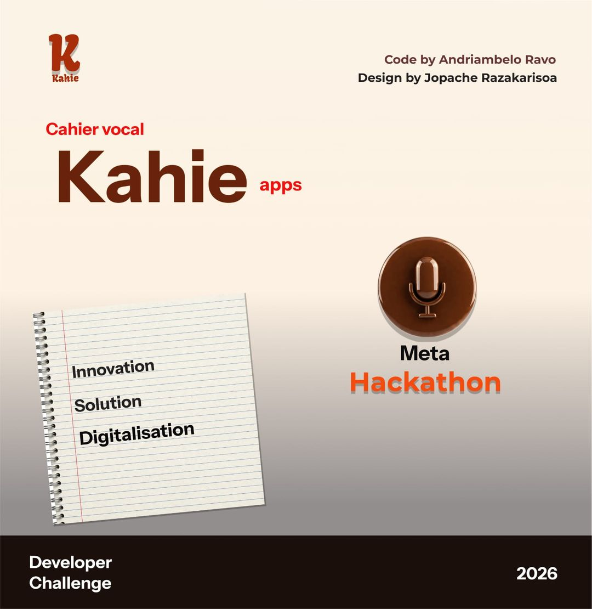

# Kahie — the voice ledger that speaks Malagasy

<p align="center"></p>

> **Kahie turns a shopkeeper's voice notes in Malagasy into a verified ledger — and the ledger into a credit history.**

Built for the **Meta Global AI Developer Hackathon 2026** — Indie Developer Track · Theme: *Build for Your World*.

🔗 **[Live Demo](https://kahie.votra-google.it)** · 🎥 **[3-min Video](https://youtube.com/...)** · 📱 **PWA — installs on any Android phone**

All code in this repository was written during the hackathon (Oct 26 – Nov 4, 2026); see the commit history.

---

## The problem

Shopkeepers in Madagascar record sales and debts in a paper notebook (*kahie*), when they have time. Debts are forgotten, notebooks get damaged, and there is no trustworthy written record to obtain microcredit. Existing tools require typing in French or English.

## What Kahie does

A shopkeeper speaks a note in Malagasy (often mixed with French):

> *"Rabe naka telo kapoaka vary, nandoa roa arivo."* — Rabe took three cups of rice, paid two thousand.

1. **Two ears** listen to the same audio: **Muse Voice Transcribe** (dedicated speech-to-text model, biased with the shop's own words) and **Muse Spark 1.2** listening to the raw audio with the merchant lexicon as context.
2. Both readings are **normalised** (spoken Malagasy numbers → digits: *roa amby telopolo* → 32; learned lexicon applied), then **reconciled**.
3. If the amounts or names disagree, the agent asks **one short question** with the two readings as choices — one tap to answer.
4. A **planner** (Muse Spark, tool calling) produces `record_sale` / `record_debt` / `record_payment` / `update_stock` / `ask_clarification` calls.
5. A **verifier** checks every call against the database (unknown product, stock, unusual price, unknown customer).
6. **Nothing is written** until the merchant taps **✓**. Then one transaction + one `audit_log` row in a SHA-256 hash chain. **Undo is always available.**
7. Every correction **teaches the lexicon** (`kapwaka → kapoaka`, `savon → savony`): it is sent as keywords to Voice Transcribe and as context to Spark, so the next note is heard correctly.
8. **Automatic calculation on the card**, before anything is written: the customer's debt *before → after*, the stock *before → after*, today's sales *before → after*. A repayment larger than the debt triggers a reinforced confirmation.
9. **Ask Kahie**: *"Iza avy no mbola tsy nandoa trosa?"* → *"Olona 2 no mbola manana trosa: Naivo 1 400 Ar, Rabe 1 000 Ar."* The planner only chooses the question (`ask_ledger`); every name and number in the answer comes from SQL, so the agent cannot invent a debt. Questions never write.
10. **Kahie speaks**: answers and the confirmation card are read aloud, with amounts in Malagasy words (*roa arivo sy valonjato Ariary*) — for shopkeepers who prefer listening to reading.
11. **Aged debts** are flagged (who has owed for more than 7 days), and a **weekly statement** sealed by the head of the hash chain is the first step toward a verifiable credit history.

## Meta models used

| Model | Role |
|---|---|
| Muse Voice Transcribe (`muse-voice-transcribe-1.0`) | Ear 1 — batch transcription with keyword biasing from the lexicon |
| Muse Spark 1.2 (audio input) | Ear 2 — listens to the raw audio with the lexicon as context |
| Muse Spark 1.3 (tools) | Planner — note → structured tool calls, or `ask_ledger` when the shopkeeper asks a question |
| Muse Spark 1.3 (vision) | Reads a photo of the existing paper notebook → debts to confirm |
| Muse Spark Open (`muse-spark-open-1026`) | Same agent on open weights — config D, *not run yet* |

Malagasy is **not** among the languages Voice Transcribe can be biased toward. Measuring how far two ears and a learning lexicon close that gap is the core result of this project.

## Verifiable agent (not a black box)

Every step of the agent loop returns a **trace** visible in the confirmation card:

| Step | What the trace shows |
|---|---|
| `ear1` | model, source, latency, heard text, error if the call failed |
| `ear2` | model, source, latency, heard text, `dropped: true` if the API silently dropped the audio |
| `normalize` | both ears after number → digit and lexicon normalisation, `changed: true` if the lexicon applied |
| `reconcile` | `agree: true/false`, the conflict (number or name), the question asked |
| `plan` | model, latency, every tool call with its arguments |
| `verify` | `level: ok/warn/clarify`, every issue |

In `mock` mode the trace says `model: "mock"` — no pretending. With an API key, the same UI shows the real model names and latency. The merchant (and the judge) can see *why* the agent asked, *which* model answered and *how long* it took.

## Install on the shopkeeper's phone

Kahie is a **PWA** — no app store, no install file.

- **Android Chrome**: open the URL → tap **"📲 Installa an'i Kahie"** (or menu → *Add to Home screen*).
- **iOS Safari**: share → *Add to Home Screen*.
- Once installed it opens full-screen with its own icon. Updates are automatic (the service worker fetches the new shell on the next launch).

## Impact — the low-end phone, the weak network

| Constraint | Kahie's answer |
|---|---|
| Old Android (2 GB RAM) | PWA, ~50 KB shell, no install file |
| Weak / intermittent 3G | A voice note is ≈ 10–30 KB (Opus, 10 s); offline queue in IndexedDB, notes are sent when the network returns |
| No typing in French | Speak Malagasy (or a mix); numbers normalised; one short question when unsure |
| No trust in the ledger | Nothing written before ✓; SHA-256 hash chain; undo; weekly statement sealed by the chain head |
| No credit history | The verified ledger is a first step toward a microcredit file (a prototype, not a partnership with any lender) |

---

## Evaluation

**60 scripted voice notes** — 30 Malagasy, 20 mixed Malagasy/French, 10 French — read by 6 speakers (written consent), about a third recorded with market noise. Six of the notes are deliberately incomplete: the right answer is to **ask**, not to write.

Each case has hand-written ideal tool calls; the expected ledger lines are produced by running the **real verifier** on a fresh demo shop (`eval/make_cases.py`), so prices, totals and debts always match what Kahie would propose.

| Config | Ear 1 | Ear 2 | Lexicon | Planner |
|---|---|---|---|---|
| **A** | Voice Transcribe | — | off | Spark 1.3 |
| **B** | Voice Transcribe + keywords | — | on | Spark 1.3 |
| **C** | Voice Transcribe + keywords | Spark 1.2 audio | on | Spark 1.3 |
| **D** | as C | Spark Open | on | Spark Open |

Measured per config: exact ledger lines, **critical errors** (a wrong product, quantity, customer, amount or stock change proposed for writing), useful questions, median latency, cost per note.

### Results

*Pending — filled only from runs on the recorded audio with the Meta models (`with_audio: 60` in `eval/results-*.json`). Results are published as measured, favourable or not.*

Day-1 API check (models, planner, first recordings through each ear): [`docs/day1.md`](docs/day1.md).

> **About the offline mock.** `mock_plan` in `models_client.py` is a rule-based **test fixture** so the tests and the UI run without an API key. Its rules were written while looking at these 60 notes, so a mock run says nothing about the Meta models and is **not** reported as a result.

## Architecture

```text
Voice note (PWA) ──┬─► Ear 1 · Muse Voice Transcribe (keywords = lexicon)
                   └─► Ear 2 · Muse Spark 1.2 audio (lexicon in context)
                                   │
                                   ▼
                   Normalisation (Malagasy numbers → digits, lexicon)
                                   │
                                   ▼
                   Reconciler (agree? → otherwise one question, two choices)
                                   │
                                   ▼
Notebook photo ──► Spark vision ─► Planner (Spark tools, JSON) ─► Verifier (DB rules → ok / warn / clarify)
                                                                        │
                                                                        ▼
                   Confirmation card (1 tap ✓ / answer / correct → lexicon learns)
                                   │
                                   ▼
                   Executor (one transaction + audit_log hash chain + undo)
                                   │
                                   ▼
                   Dashboard · aged debts · weekly statement (sealed)
```

Nothing is written to the database before the merchant taps ✓.

## How to run

**Prerequisites:** Python 3.11+, `ffmpeg` on the PATH (`ffmpeg -version` — browser webm/opus → WAV), and a Meta Model API key. Without a key Kahie runs in mock mode, so the tests and the UI still work.

```bash
git clone https://github.com/Laingo12/kahie.git && cd kahie
python -m venv .venv
# Windows: .venv\Scripts\activate      Unix: source .venv/bin/activate
pip install -r requirements.txt
cp .env.example .env        # set MODEL_API_KEY; leave KAHIE_BACKEND empty
uvicorn app.main:app --app-dir backend --reload
# open http://127.0.0.1:8000/
```

Tests (no network needed):

```bash
python -m pytest -q
```

Day-1 API check and evaluation:

```bash
python eval/day1_test.py                     # models, planner, first recordings → docs/day1.md
python eval/make_cases.py                    # rebuilds eval/cases.jsonl (60 cases)
python eval/run_eval.py --config C           # uses eval/audio/<id>.<ext> when present
for c in A B C D; do python eval/run_eval.py --config $c --out eval/results-$c.json; done
```

## Repository layout

```text
backend/app/
  main.py              FastAPI: /api/voice /image /clarify /confirm /undo /lexicon /report /alerts /debt /statement /verify /health
  config.py            Settings from .env
  models_client.py     Meta Model API: Voice Transcribe (ear 1), Spark audio (ear 2), planner, vision + offline mock
  numbers_mg.py        Spoken Malagasy/French numbers ↔ digits (roa amby telopolo ↔ 32), speakify() for speech
  lexicon.py           Learned lexicon → keywords, prompt, normalize()
  audit.py             Hash chain (append, set_result, verify)
  db.py, schema.sql    SQLite tables + fictional demo shop
  agent/
    pipeline.py        listen → normalise → reconcile → plan → verify → pending; clarification; agent trace
    reconciler.py      Compare the two ears; one question with two choices
    verifier.py        DB rules → ok | warn | clarify
    executor.py        Transaction + audit + undo
    answers.py         Read-only answers to questions (who owes, balance, sales, stock) from SQL
    preview.py         Automatic calculation shown on the card (before → after) + spoken summary
    tools.json         Tool schema sent to Spark (5 write/clarify tools + ask_ledger)
frontend/              PWA, no build step (index.html, app.js, styles.css, sw.js, manifest.json)
eval/
  make_cases.py        Builds cases.jsonl from the 60 scripted notes + the real verifier
  cases.jsonl          60 cases (30 mg, 20 mix, 10 fr; 6 must be asked)
  run_eval.py          Scores exact lines, critical errors, questions, latency per config
  day1_test.py         First real API check → docs/day1.md
tests/                 API flow, numbers, two ears, lexicon, clarification, Voice Transcribe request, answers, preview
deploy/                systemd unit, nginx (HTTPS via certbot), setup.sh, deploy.sh
docs/                  meta-api-notes.md, day1.md, submission.md
```

Not in the repository on purpose: `.env` (the API key), `data/` and `*.db`, `eval/audio/` (recordings — published only if every speaker agreed in writing), `eval/results-*.json` until the audio runs are final, `video/`.

## Limitations (stated honestly)

- **Malagasy speech recognition** is the open question; the audio results above will say how well the Meta models handle it.
- **Config D (open weights)** is not run yet — it needs partner credits (Baseten / Modal / Fireworks). The code path exists (`models_client._client(open_weights=True)`).
- **Ear 1 alternatives** (`EAR1_MODE`): `spark_literal` (Spark with a literal prompt — same model as ear 2, so not an independent ear) and `whisper` (not a Meta model; optional comparison only). The default is Voice Transcribe.
- **Speech** uses the phone's own speech synthesiser. Browsers ship no Malagasy voice, so Kahie uses one if the phone has it, otherwise a French voice reading Malagasy text (understandable, accent imperfect).
- **Notebook photo** goes through one Spark vision call; long handwritten pages may need line-by-line reading (roadmap: SAM 3.1 line segmentation).
- **Numbers:** "X sy Y arivo" multiplies only Y (*dimy amby roapolo sy zato arivo* → 100 025, not 125 000). Shop notes rarely say this; the confirmation card shows the amount before anything is written.
- **Audio drop guard:** the Spark audio ear may silently drop audio on some tiers — `listen_with_spark` checks `prompt_tokens` and reports `dropped: true` instead of guessing.
- **The hash chain is tamper-evident, not tamper-proof:** whoever controls the server could recompute it. The sealed statement held by the shopkeeper is what makes later edits visible.

## Team

<!-- list every team member exactly as on the submission form -->
- Laingo Andriambelo Ravo — code · [GitHub](https://github.com/Laingo12)
- Jopache Razakarisoa — design (brand, poster, app theme)

## License

MIT — see [LICENSE](LICENSE).
